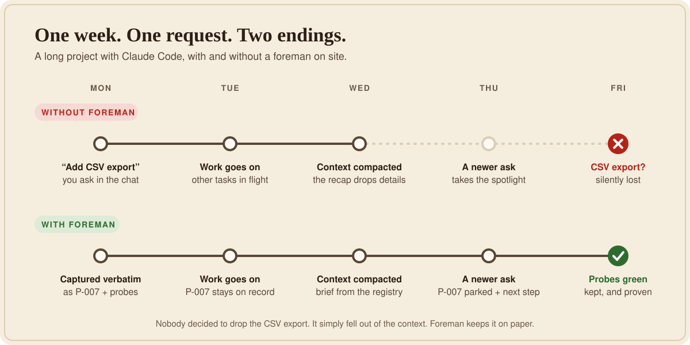
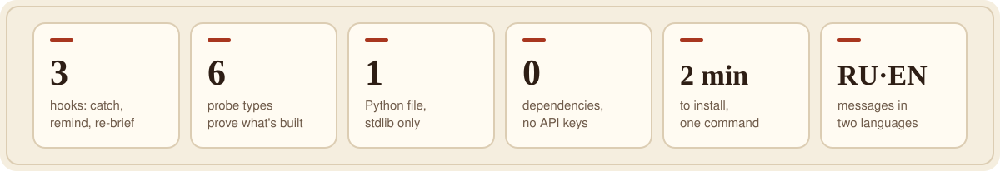
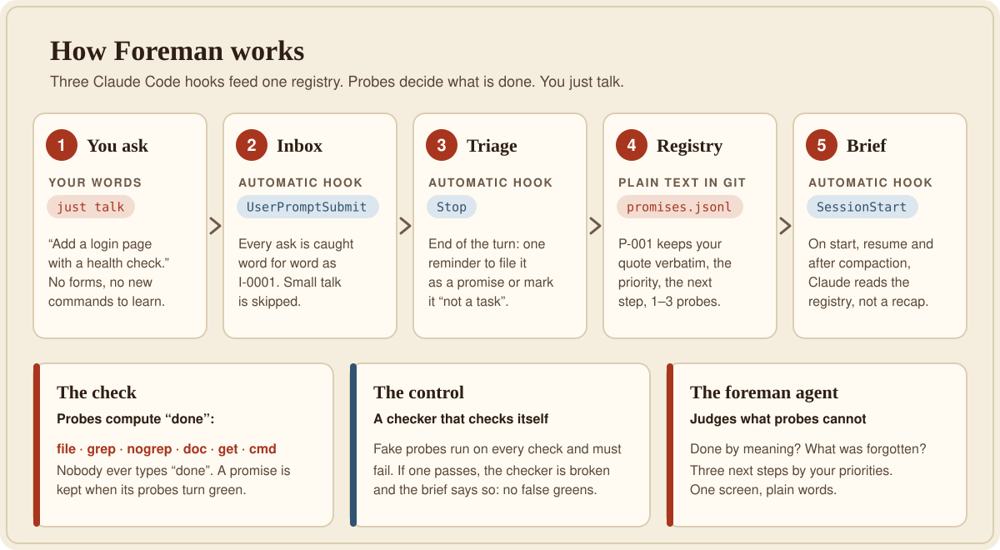
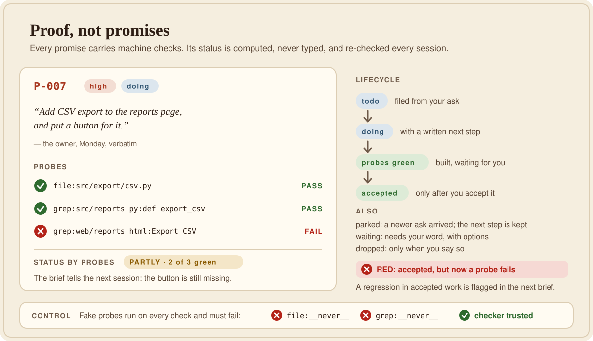
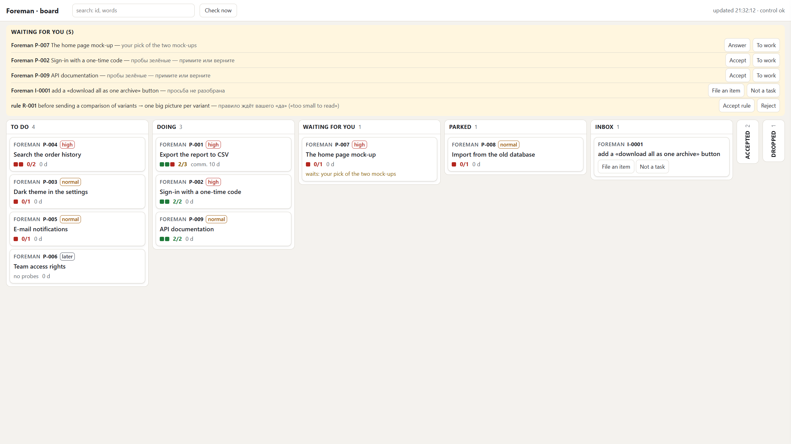

<p align="center">
  
</p>

<h1 align="center">Foreman · Прораб</h1>

<p align="center">
  <b>Your project's promises don't get lost.</b><br>
  The site foreman for Claude Code: it writes down every request you make, word for word,<br>
  attaches machine checks to it and keeps asking <i>"is it really built?"</i> until the answer is yes.
</p>

<p align="center">
  
  
  
  
  
</p>

<p align="center">
  <a href="#install-in-2-minutes"><b>Install in 2 minutes</b></a> ·
  <a href="#how-it-works">How it works</a> ·
  <a href="#council-mode-for-the-hard-ones">Council mode</a> ·
  <a href="#lessons-foreman-learns-from-your-corrections-20">Lessons (2.0)</a> ·
  <a href="#foreman-vs-the-alternatives">Foreman vs. the alternatives</a> ·
  <a href="#faq">FAQ</a> ·
  <a href="README.ru.md">Русская версия</a>
</p>

---

## The problem: long projects leak promises

You ask Claude for something on Monday. On Wednesday the context gets compacted, a newer request takes the spotlight, and Monday's ask quietly falls out. Nobody decided to drop it. It just got lost.

On a project that runs for weeks this keeps happening, and you find out at the worst moment: in a demo, in a release, in front of a client. Foreman was born after an audit of one such project found **seven lost promises of the same kind**.

<p align="center">
  
</p>

## Meet Foreman

Foreman keeps **one registry of everything you asked for**, in your own words, and computes what is really done from machine checks instead of anyone's memory.

| | |
|---|---|
| **Catches every ask, automatically.**<br>A Claude Code hook files each request into an inbox, word for word. You don't fill in forms or learn commands; you just talk. | **Proof, not promises.**<br>Every promise carries 1–3 *probes*: "this file exists", "this function is in the code", "this page answers". "Done" is computed, never typed. |
| **Survives context compaction.**<br>After every session start, resume and compaction, Claude gets a brief from the registry, not from a lossy recap. | **A checker that checks itself.**<br>Fake probes run on every check and must fail. If one ever passes, Foreman says the checker is broken instead of showing false greens. |
| **Parks work instead of dropping it.**<br>A new ask mid-task? The current item is parked with a written next step first, then the new one starts. | **Catches regressions.**<br>If something you already accepted stops passing its probes, it lights up **RED** in the next brief. |
| **A foreman, not a bricklayer.**<br>The `foreman` agent judges what probes can't: is it done by meaning, what was forgotten, the three next steps by your priorities. One screen, plain words. | **Tiny, local, private.**<br>One Python file, standard library only. No API keys, no servers, no telemetry. Your registry is plain JSONL in your repo. |

<p align="center">
  
</p>

## How it works

<p align="center">
  
</p>

Three Claude Code hooks do the bookkeeping, so neither you nor Claude has to remember to:

| # | Hook | When it fires | What it does |
|---|---|---|---|
| 1 | `UserPromptSubmit` | you send a message | Recognises a request ("add", "fix", "please", "сделай", "нужно"…) and files it verbatim into `.foreman/inbox.jsonl`. Small talk ("ok", "thanks") is ignored. |
| 2 | `Stop` | Claude finishes its turn | Reminds Claude **once** to triage new asks: file a promise with probes, attach it to an existing one, or mark it "not a task". |
| 3 | `SessionStart` | start, resume, **compaction** | Injects a short brief computed from the registry: what is in progress, what is next, what is built and waiting for you, what turned red. |

## Proof, not promises

<p align="center">
  
</p>

A promise is kept when its probes turn green. Seven kinds of probes cover most of what "built" means:

| Probe | Turns green when | Example |
|---|---|---|
| `file:path` | the file exists (globs work) | `file:src/export/*.py` |
| `grep:file:regex` | the code contains the pattern | `grep:src/app.py:def login` |
| `nogrep:file:regex` | the file exists **and** the pattern is gone | `nogrep:README.md:TODO` |
| `doc:file:word` | a word appears in the docs (any case) | `doc:docs/api.md:export` |
| `get:url` | an HTTP GET answers below 400. A server that is down counts as "not checked", never as "not built" | `get:http://localhost:8000/health` |
| `cmd:command` | a shell command exits with 0. **Off by default** because it runs code; enable it with `allow_cmd` | `cmd:pytest -q tests/test_login.py` |
| `fresh:result:glob` | the result (a test report, a build, a render) is **newer than every file** of the glob — a test counts only if it ran after the last edit (2.1) | `fresh:reports/junit.xml:src/**/*.py` |

A probe that **could not run** — a server down, a timeout, no access, a broken regex, an unknown kind, `cmd:` switched off, a pattern
that finds nothing — is **unknown**, with its reason (`check P-007` shows it), never a red "not built" and never a green. One real
"no" outranks any unknown; green + unknown is not "done" (2.1).

Statuses you (or Claude, on your word) set by hand: `todo` · `doing` · `waiting` (for you) · `parked` · `accepted` (after **you** accept it) · `dropped` (only on your word). "Done" is never one of them: the probes decide.
An acceptance covers *that* quote with *those* probes: change either afterwards and the item goes back to `doing` (`accept_void`), until you
accept it again (2.1). Claude Code's own task list is guarded too (wherever Claude uses its task tools): a task that names `P-…` cannot be marked
completed while that item has a red probe (the `TaskCompleted` hook).

## Council mode: for the hard ones

Some promises are hard: the first attempt fails its probes twice, or a wrong decision is expensive (architecture, data model, public API). For those, Foreman runs a **council**: a short, bounded search that keeps the best *verified* solution instead of endlessly rewriting the latest one.

More rewriting is not more quality. A model that keeps polishing its own answer often makes it worse, and with a weak judge every extra round only adds confidence in a mistake. So the council is built around the parts that keep a search honest:

1. **Criteria first.** The item's probes and a short rubric of soft criteria are fixed *before* the search. After the first round they're frozen: `foreman.py` refuses to change them without `--force`.
2. **A kept leader.** The current version always competes. A new candidate replaces it only if it is verifiably better.
3. **2–3 really different candidates** per round, each in its own git worktree — or, in a folder that is not a git repository, in a copy of the part it changes (or as a diff / plan). Irreversible actions (deploys, migrations, deletions) get candidate *plans*, never repeated executions.
4. **The objective check:** `foreman.py compare` runs the same probes on every candidate side by side.
5. **A blind judge:** the `foreman-judge` agent ranks anonymous candidates X/Y/Z by the frozen rubric, with evidence, without knowing which one is the leader. "Tie" is an allowed answer.
6. **A journal and a stop rule:** `foreman.py round` logs every round and calls STOP after 2 rounds without a gain or 3 rounds in total. You get the **best** version found, not the last one, plus a short account of what was tried and rejected. If the choice is a matter of taste, the finalists come to you.

```text
$ python .foreman/foreman.py compare P-007 L=. A=../app-p007-a B=../app-p007-b
P-007: comparison by probes (the objective part; meaning and taste go to the blind judge foreman-judge):
  L (.): not 0/3 · ✗ file:src/csv.py; grep:src/csv.py:def export_csv; grep:web/index.html:Export CSV
  A (../app-p007-a): partly 2/3 · ✗ grep:web/index.html:Export CSV
  B (../app-p007-b): done 3/3
Most green probes: B
```

Start one by saying **"council on P-007"** (or «консилиум», «подумай как следует»). Simple tasks don't need it: a council costs a few extra passes, and Foreman suggests it only where it pays off.

## Lessons: Foreman learns from your corrections (2.0)

Promises say **what** you asked for. Lessons say **how** you want things done. When you correct Claude ("again you sent a giant table,
nothing is readable"), the correction should not vanish with the session either.

- **A correction becomes a rule** in `.foreman/rules.jsonl`: *when* (the situation) → *do* (the operation) + your words **verbatim** + a few
  RU/EN keywords. A rule Claude writes is born **proposed**; it becomes **active** only on your word (`rule accept R-003`). An agent's guess
  is never a law.
- **Found again before the next action.** The prompt hook searches your rules (stemmed Russian and English, BM25 with a trigger
  field; synonyms from the lexicon re-rank) and shows the 1–3 that fit the message — a rule shows only when the message hits its
  *when* or keys. An ordinary message costs **zero** characters; a hard cap of 1,200 characters per
  message keeps the context small.
- **A correction must leave a record.** If your last message looks like a correction (cues in Russian and English, such as «опять»,
  "you forgot", "I told you"), the end of the turn is blocked until a rule was really written (a write to the rules or the ledger since
  your message) or Claude explains «not a correction: …». The words "recorded" alone don't count, and neither does a command that only
  reads the rules. The app's own rows (the compaction summary, a background agent's notice, the hook's feedback) are never taken for
  your message.
- **A ladder for repeats:** level 0 note → 1 rule (recalled by words) → 2 hot (always in the session brief) → 3 **guard**: a probe
  checked at the end of every turn (`nogrep:README.md:TODO`). A guard that turns red blocks once; one red from the start never locks you out.
- **Rules age honestly (2.1).** Accepting a rule stamps the date; the session brief lists active rules nobody confirmed for
  `lessons.confirm_days` (60) — `rule confirm R-003` or `rule replace R-003 --by R-007` (a replaced rule is kept, marked, and no longer
  recalled). A lesson may also be put off with a reason — «отложено: …» / "deferred: …" passes the Stop gate, is logged once and counted
  in the brief (`cues --deferred`).
- **Measured, not hoped.** Each rule keeps the message it came from (and optionally one it must NOT fire on); `recall --eval` reports
  recall@3 and false positives on your own project.
- **Works with Claude Code's own memory.** Foreman reads it (and `CLAUDE.md`, your skills) as a source and never writes there: your rulings go
  to `rules.jsonl`, Claude's working notes stay in its memory.
- **Empty start.** A new project has no rules and pays nothing until your first correction. Don't want lessons? Install with
  `--modules promises`.

```text
FOREMAN·lesson: looks like a CORRECTION («again»). Before the turn ends: (1) already a rule? (recall) … (5) ONE rule: python
.foreman/foreman.py rule add '{"when", "do", "quote": verbatim, "keys"}' --situation "<this message>". End the reply with
«recorded: R-…» (after writing it) or «not a correction: <why>».
FOREMAN·recall (by the message):
  R-003 before sending a comparison sheet → one big picture per variant («the table is unreadable»)
```

Where it comes from: the memory system of the project Foreman was born in (itself grown from
[google-research/harness2](https://github.com/google-research/harness2)), cut down to what any project can use, and decided by a council
of three models (Claude Fable, Gemini, GPT) on 4 November 2026.

## The board: every item on one page (2.1)

`python .foreman/foreman.py board` (on Windows: double-click `.foreman/board.bat`) opens a local page with **every** item of the
registry — not only those that wait for you:

- **Columns are statuses**: to do · doing · waiting for you · parked · inbox, plus the folded rails «accepted» and «dropped».
  Drag a card to another column — its status changes; drag it within a column — that is its priority (`rank`), and the brief follows
  your order. "Done" is never a column: the probes decide.
- **«Waiting for you»** on top — one honest list (its length is the number in its title): items waiting for your decision, green items
  not yet accepted, accepted items gone red, unsorted asks, rules waiting for your «yes» — each with buttons right on the line.
  **«What is broken»** shows only when something is.
- **The item panel**: the quote verbatim, the next step, the probes (✓ ✗ ?, with the reason for «unknown»), comments with an input
  field, the item's history. **Accept** asks once more — and it is your word: the click writes a line to the owner's log.
- **Claude sees your moves** at your next message: «FOREMAN·board (owner): P-017 → waiting, comment «…»; order changed».
- **Several registries on one board.** Besides its own, Foreman shows any registry whose command speaks `--json --light / --set /
  --rank / --comment / --accept / --skip` (`board.registries`, kind `cli`, with its own status words) — each written only through its
  own command, so its own guards apply.
- **Safety:** 127.0.0.1 only; the start key is printed to YOUR terminal (without a terminal the board starts only with
  `--token-file`); if Claude changed an item meanwhile you get a red bar with «Retry» instead of an overwrite.

<p align="center"></p>

## Model panel: several AIs on one hard question (2.2, optional)

For decisions that are costly to get wrong, Claude can gather independent opinions from the AI models **you already have** and decide
with you on checked facts. It is offered at install — **you decide** whether you want it; a silent install leaves it off.

- **Who can sit on the panel:** Claude's own subagents of other models (always there, nothing leaves your machine); command-line tools
  found on your computer — Codex CLI (also inside the Codex app's folder), Gemini CLI, Qwen Code, `llm`; any OpenAI-compatible API whose
  key is in your environment (OpenAI, Gemini, OpenRouter, DeepSeek, xAI, Mistral — the key is read by its variable's NAME and never
  written anywhere); local Ollama / LM Studio; a web chat of yours by hand. `python .foreman/foreman.py panel detect` shows them.
- **How it works:** one self-contained brief (`panel new "<topic>"`) → every member answers independently, in parallel, each into its
  own file (`panel run <folder>`; one member can be given the critic's role, `--stance codex=против`) → optionally a second round where
  each sees the others' answers without names and names their errors (`panel review`) → Claude checks every claim against your code and
  writes `DECISION.md`: verified facts, what all agree on, where they differ and what was chosen, what each member gave.
- **Safeguards:** a brief that looks like it carries a key, a token, a password, an e-mail or a path with your user name is never sent;
  it leaves your machine only after **you** said so — Claude asks, and the engine checks your words verbatim against your logged messages
  (`panel.ask_each_time`, `--owner-ok`); only the members you switched on take part (a model found later joins switched off); a
  command-line member works in an empty temporary folder (it sees the brief, nothing of your project) without the API keys it must not
  use (Codex keeps your ChatGPT sign-in instead of a paid key); a member you wrote yourself into `config.json` runs only with
  `allow_cmd`; a member that fails or hangs is stopped with its child processes and never stops the others.
- Switch on later: `install.py <project> --modules promises,lessons,panel` (or `"panel": true` in `config.json → modules`).

## Who checks the checker (2.1)

- **«Accepted» only with your words.** Foreman logs your messages verbatim (`.foreman/owner.jsonl`); `set P-007 status=accepted` and
  `rule accept R-003` need `--quote "<your words>"`, checked against that log (a paraphrase is refused; a short «yes» counts only as the
  answer to a reply that named the item). Changing an accepted item's quote or probes takes the acceptance back.
- **The edit gate.** A turn that wrote Foreman's own files, the hook settings or your guarded paths directly (not through Foreman's
  commands), or drove the board, is stopped once until Claude says why: «checks edited: <why>».
- **Earlier acceptances** are marked `legacy` on the update; anything accepted around the check shows in the brief.

## Foreman vs. the alternatives

**Foreman is not another task manager.** Task managers track the work an agent plans. Foreman guards the promises *you* made, in your own words, and proves they were kept. It's the part that's missing when the plan is fine but Monday's request still disappears.

| | **Foreman** | Claude Code's built-in task list | [Task Master](https://github.com/eyaltoledano/claude-task-master) | [Backlog.md](https://github.com/MrLesk/Backlog.md) |
|---|---|---|---|---|
| Captures your requests automatically | ✅ every message, via a hook | ➖ Claude builds its own list from a plan | ➖ tasks generated from a PRD | ➖ tasks created via CLI or MCP |
| Keeps your exact words | ✅ verbatim quote in every item | ❌ Claude's own wording | ❌ generated wording | ➖ whatever was typed in |
| "Done" is proven by machine checks | ✅ seven probe types | ❌ set by the agent | ❌ set by the agent or you | ❌ set by the agent or you |
| The checker verifies itself | ✅ control probes must fail | ❌ | ❌ | ❌ |
| Restores open work after compaction | ✅ automatic, `SessionStart` hook | ➖ within its own session | ➖ when the agent queries it | ➖ when the agent reads it |
| Flags regressions in accepted work | ✅ RED in the next brief | ❌ | ❌ | ❌ |
| Hard cases: compares candidates, keeps the best verified one | ✅ council with a blind judge | ❌ | ❌ | ❌ |
| Learns from your corrections: your words become a rule, found again and enforced | ✅ lessons, Stop gate, guards | ➖ Claude's own notes (memory), not enforced | ❌ | ❌ |
| Planning, task breakdown, kanban | ❌ not its job | ➖ a simple checklist | ✅ PRD → tasks with dependencies | ✅ kanban board and web UI |
| What you install | one Python file, standard library | nothing, it's built in | Node.js package + a model provider or the Claude Code CLI | npm/bun/Homebrew/Nix package |

<sub>✅ yes · ➖ partly or indirectly · ❌ no. Based on each project's public documentation as of November 2026; if something here is out of date, please <a href="https://github.com/BenderBlender/Claude-Code-Foreman/issues">open an issue</a>.</sub>

**Closer neighbours, each strong at one part** (checked against their own docs, November 2026):
[claude-reflect](https://github.com/BayramAnnakov/claude-reflect) turns your corrections into permanent instructions (mature, many tests),
but it does not block a turn and does not keep a registry of your asks;
[claim-check](https://github.com/Arnav66692/claim-check) blocks a run when the agent's "created / ran / tests pass" claim is false —
a Stop gate on claims, not on your requests; [claude-task-tracker](https://github.com/ProblemFactory/claude-task-tracker) logs requests
passively in the AI's own words. Foreman's combination — your asks verbatim + probes that compute "done" + a control that checks the
checker + lessons that must leave a record + a council — we have not found elsewhere; if you know a tool that does it, tell us.

**Why people pick Foreman:**

- **Zero effort.** You don't change how you talk to Claude. The hooks do the bookkeeping.
- **Honest by construction.** Nobody can mark a promise "done" to look good. Probes decide, and the control keeps the probes honest.
- **Built for long projects.** Weeks of sessions, dozens of compactions, requests made in passing: that's exactly where things get lost, and where Foreman helps most.
- **Plays well with others.** Keep Task Master or Backlog.md for planning. Foreman sits next to them and makes sure nothing you asked for falls through the cracks.
- **Safe to try.** It touches only your project folder, backs up your settings first and uninstalls cleanly while keeping your data.

## Install in 2 minutes

**You need:** [Claude Code](https://claude.com/claude-code) and [Python 3.8+](https://www.python.org/downloads/) (on Windows, tick *"Add python.exe to PATH"*).

**1. Get Foreman**

```bash
git clone https://github.com/BenderBlender/Claude-Code-Foreman.git
```

or click **Code → Download ZIP** on this page and unpack it.

**2. Install it into your project**

<table>
<tr><th>macOS / Linux</th><th>Windows</th></tr>
<tr>
<td>

```bash
cd Claude-Code-Foreman
./install.sh /path/to/your/project --lang en
```

</td>
<td>

Double-click `install.bat`, drag your project folder into the window and press **Enter**. Or from a terminal:

```bat
install.bat "C:\path\to\project" --lang en
```

</td>
</tr>
</table>

**3. Restart Claude Code in that project** (or open `/hooks` and accept the changes). That's it.

The installer runs a self-test before it finishes:

```text
Done. Foreman is installed.
Self-test: the control worked (the fake probes failed), the session hook answers.
```

<details>
<summary><b>What exactly changes in your project</b></summary>

Nothing outside the project folder is touched.

| What | Where | Notes |
|---|---|---|
| The engine and your data | `.foreman/` (`foreman.py`, `promises.jsonl`, `inbox.jsonl`, `config.json`) | your registry is kept on every update |
| Lessons (2.0) | `.foreman/` (`recall.py`, `lexicon.json`, `rules.jsonl`, `ledger.md`, `eval.jsonl`, `events.jsonl`, `RULES.md`) | `lexicon.json` is yours to extend and is never overwritten |
| Three hooks | `.claude/settings.local.json` | your personal settings file, usually not committed; the previous version is backed up to `.foreman/backup/` and your own hooks are kept |
| The `foreman` agent | `.claude/agents/foreman.md` | |
| The blind judge | `.claude/agents/foreman-judge.md` | used by the council |
| The council procedure | `.claude/skills/foreman-council/SKILL.md` | loaded only when a council runs |
| A rules section | `CLAUDE.md`, between `<!-- foreman:start -->` and `<!-- foreman:end -->` | the rest of the file is left alone |

</details>

## Using it

**Just talk.** Ask for things the way you always do. Claude files each request as a promise with your quote and probes.

**Ask "What's the project status?"** You get the brief, plus a one-screen report from the `foreman` agent: done since last time, in progress, waiting for you, forgotten or stuck, and the three next steps.

A brief looks like this:

```text
FOREMAN (01.11 19:50; registry .foreman/promises.jsonl): 12 items · by probes done 7 · partly 2 · not 3 · waiting for you 1
In progress: P-009 «CSV export for reports» → add the Export button to web/reports.html
Next by priority: P-011 «Rate limits per plan»; P-012 «Dark theme»
Probes green but status «todo/doing» — verify and mark «accepted»: P-010
RED — «accepted» but the probes disagree: P-004 «Health endpoint»
Control: ok (the fake probes failed)
Parking: a new ask mid-work → set P-… status=parked next="…" on the current item first, then the new one.
```

**Accept the work** by telling Claude "P-007 accepted". Its status becomes `accepted`, and from then on the probes guard it against regressions.

**By hand**, if you like:

```bash
python .foreman/foreman.py brief            # the short brief
python .foreman/foreman.py status           # full report into .foreman/STATUS.md
python .foreman/foreman.py add '{"title": "…", "quote": "…", "probes": ["file:…"]}'
python .foreman/foreman.py set P-003 status=parked next="…"
python .foreman/foreman.py take I-0002 --as P-007     # or: skip I-0002 --why "a question, not a task"
python .foreman/foreman.py selftest

# council
python .foreman/foreman.py check P-007 --root ../app-p007-a     # one item's probes on another folder
python .foreman/foreman.py compare P-007 L=. A=../app-p007-a B=../app-p007-b
python .foreman/foreman.py round P-007 '{"tried": ["L","A","B"], "winner": "B", "accepted": true, "why": "…"}'

# lessons (2.0)
python .foreman/foreman.py recall send a comparison of variants       # the rules that fit what you are about to do
python .foreman/foreman.py rule add '{"when": "…", "do": "…", "quote": "…", "keys": "…"}' --situation "the owner's message"
python .foreman/foreman.py rule accept R-003      # the owner's word: proposed → active
python .foreman/foreman.py rule confirm R-003     # still true (the brief lists rules unconfirmed for 60 days)
python .foreman/foreman.py rule replace R-003 --by R-007                 # stopped being true: kept, marked, not recalled
python .foreman/foreman.py cues --deferred        # lessons put off with «отложено: …»
python .foreman/foreman.py rule set R-003 hot=true                     # level 2: always in the brief (active rules only)
python .foreman/foreman.py rule set R-003 guard=nogrep:README.md:TODO level=3
python .foreman/foreman.py recall --eval          # recall@3 and false positives on your own cases
```
In Windows PowerShell 5.1 the quotes inside a JSON argument get stripped: put the JSON in a file and pass `@rule.json`.

## Configuration

`.foreman/config.json`:

| Key | Default | Meaning |
|---|---|---|
| `lang` | `"ru"` | language of messages: `"ru"` or `"en"` (set by `--lang` at install) |
| `stale_days` | `3` | after how many days without movement an item in progress counts as stuck |
| `allow_cmd` | `false` | allow `cmd:` probes (they run shell commands) |
| `orphans` | empty | find abandoned files nothing references, e.g. `{"candidates": ["src/**/*.py"], "corpus": ["**/*.py", "**/*.md"]}` |
| `extra_ask_cues` | `[]` | your own regex cues that mark a message as a request |
| `council` | `{"candidates": 2, "max_rounds": 3, "stop_after": 2}` | candidates per round, the round limit, and how many rounds without a gain stop the council |
| `modules` | `{"promises": true, "lessons": true, "board": false}` | a module that is off adds nothing to any hook (`install.py --modules promises`) |
| `budget` | `{"prompt_chars": 1200, "session_chars": 2000, "recall_hits": 3, "recall_chars": 700, "hot_rows": 5}` | hard caps on what the hooks add to the context |
| `lessons.stop_gate` | `"correction"` | `"off"`: never block; `"correction"`: block a correction without a record; `"all"`: teachings too |
| `lessons.extra_correction_cues` / `extra_teaching_cues` | `[]` | your own regex cues |
| `lessons.rules_extra` | `[]` | globs of an existing rule book (markdown tables / `###` sections) to search read-only; a book with laws (`### P1 · …` sections, rows tagged `[P1]`) gets the law layer: the rows of the law the situation falls under rank higher |
| `lessons.record_paths` | `[]` | regexes of your own files whose edit also counts as a lesson record at the Stop gate (e.g. your rule book) |
| `lessons.record_hint` | `""` | where a lesson is written in this project (e.g. "a row in docs/rules/<area>.md"); the lesson note and the Stop gate then point there instead of `rule add` |
| `lessons.confirm_days` | `60` | an active rule unconfirmed for longer is listed in the brief (`0` = never) |
| `board` | `{"port": 8765, "poll_s": 3, "registries": []}` | the board's port, its refresh period, external registries (kind `cli`: `cmd`, `statuses`, `write_status`, `priorities`, `states`, `tags_from_status`) |
| `lessons.edit_gate` / `lessons.guard_paths` | `"on"` / `[]` | the edit gate; regexes of your own files it guards too |
| `panel` | `{"ask_each_time": true, "timeout_s": 600, "members": [...]}` | the model panel (module `panel`, off by default): ask before a brief leaves the machine, one time limit for the whole round, the members found at install. A member: `enabled`, `model`, `params` (merged into an API request: effort, temperature…), `args` (a CLI's own flags, e.g. a model or an effort), `strip_env`, `num_ctx` (Ollama's context, default 32768 — sent through Ollama's own `/api/chat`, since its OpenAI-compatible address cannot set it). Placeholders in a CLI's `cmd`: `{out}` (the answer file), `{dir}` (its empty working folder). The installer asks about the panel once; `install.py … --ask-panel` asks again. Windows: a `.cmd` shim runs through `cmd.exe`, so a project path with `%` in it may be expanded — keep such paths out. |
| `accept_days` | `14` | how old the owner's words may be for an acceptance |
| `lessons.memory_dir` | `"auto"` | Claude Code's memory folder (read-only); `auto` finds `~/.claude/projects/<project>/memory` |

## Uninstall

```bash
./install.sh /path/to/project --uninstall --lang en    # Windows: install.bat "C:\path\to\project" --uninstall --lang en
```

This removes the hooks, the agent and the `CLAUDE.md` section. **Your data in `.foreman/` stays.** Add `--purge` to move `.foreman/` aside as `.foreman_removed_<time>`. It is never erased.

## FAQ

<details>
<summary><b>Does Foreman send my code or prompts anywhere?</b></summary>

No. Everything runs locally as a small Python script. The only network calls are the `get:` probes you write yourself, against URLs you choose.
</details>

<details>
<summary><b>Will it slow Claude down or break my session?</b></summary>

The hooks are short local Python runs with hard timeouts (10 seconds for the inbox and reminder hooks, 30 for the brief, which runs your probes). A hook that fails is silently ignored, because a hook must never break the session.
</details>

<details>
<summary><b>I already have hooks in my project.</b></summary>

The installer merges with them. Your hooks stay, only Foreman's own entries are added or replaced, and the old settings file is backed up first.
</details>

<details>
<summary><b>Can my team share the registry?</b></summary>

Yes. `.foreman/promises.jsonl` is plain text in your repo; commit it to keep history and share it. The hooks live in each person's `.claude/settings.local.json`, so everyone who wants the automation runs the installer once.
</details>

<details>
<summary><b>My messages are in English. Does request detection work?</b></summary>

Yes. Request cues are built in for both English and Russian, whatever the message language setting is, and you can add your own with `extra_ask_cues`.
</details>

<details>
<summary><b>The server was down and my <code>get:</code> probe failed. Is the item now "not built"?</b></summary>

No. A server that doesn't answer makes the probe "not checked", never "not built". Foreman won't call your work missing just because a server is offline.
</details>

<details>
<summary><b>Does it fight with Claude Code's own memory?</b></summary>

No. Foreman only reads Claude Code's memory folder (and `CLAUDE.md`, your skills) to find what fits a message. It never writes there. Your
rulings live in `.foreman/rules.jsonl` with your exact words; Claude's own notes stay where Claude keeps them.
</details>

<details>
<summary><b>I don't want the lessons, only the promises.</b></summary>

Install with `--modules promises` (or set `"modules": {"lessons": false}` in `.foreman/config.json`). An off module adds nothing to any hook.
</details>

<details>
<summary><b>How much context do the hooks cost?</b></summary>

An ordinary message: nothing. A request: one short inbox line. A correction: the lesson protocol plus at most three fitting rules, never
more than 1,200 characters in all. The session start: the brief plus hot rules, at most 2,000 characters. All caps are in `budget`.
</details>

<details>
<summary><b>The board does not open (or shows a list of files).</b></summary>

Start it from a terminal or by double-clicking `.foreman/board.bat`: the link with the start key is printed in that window, and the
browser opens it. If the configured port (8765) is taken by another program, the board takes the next free one and says so in the
window — use the link printed there. A leftover helper server (for instance `python -m http.server 8765` that an agent started for a
test and forgot) is the usual culprit: since 2.1.1 the board takes its port exclusively, so it can no longer «share» a busy port and
send your browser to the wrong server.
</details>

## The story

Foreman was built by Claude together with a film producer who was building a 3D previsualisation studio with Claude Code, in November 2026. An audit of that project found seven lost promises of the same kind. The design was chosen by a panel of four models (Fable, a Claude critic, ChatGPT and Gemini), and all four said the same thing: a separate "boss" that reads the same notes would lose things the same way. What you need is a registry where *readiness is computed by a check, not by memory*.

Other tools manage tasks. Foreman keeps **a person's promises, verbatim**, and checks for itself whether they were kept.

## License

[MIT](LICENSE) © 2026 BenderBlender. Bug reports and ideas are welcome in [Issues](https://github.com/BenderBlender/Claude-Code-Foreman/issues).
