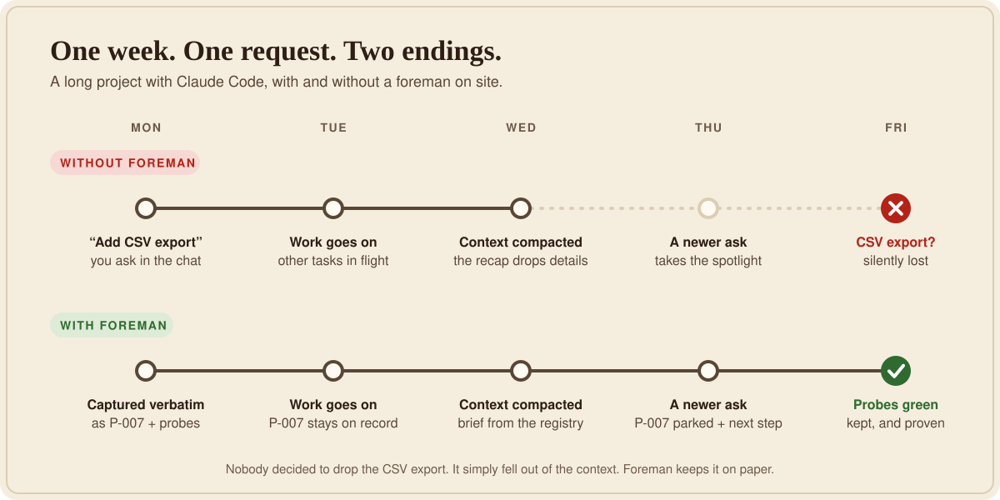
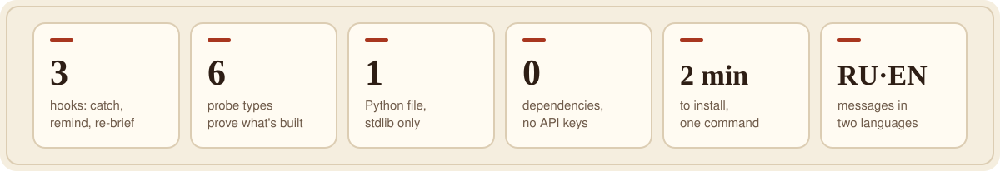
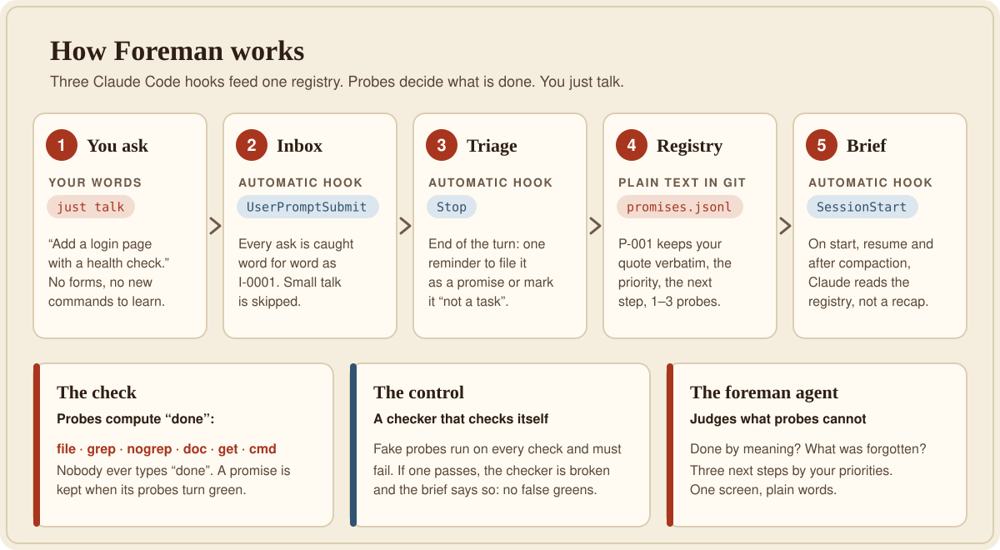
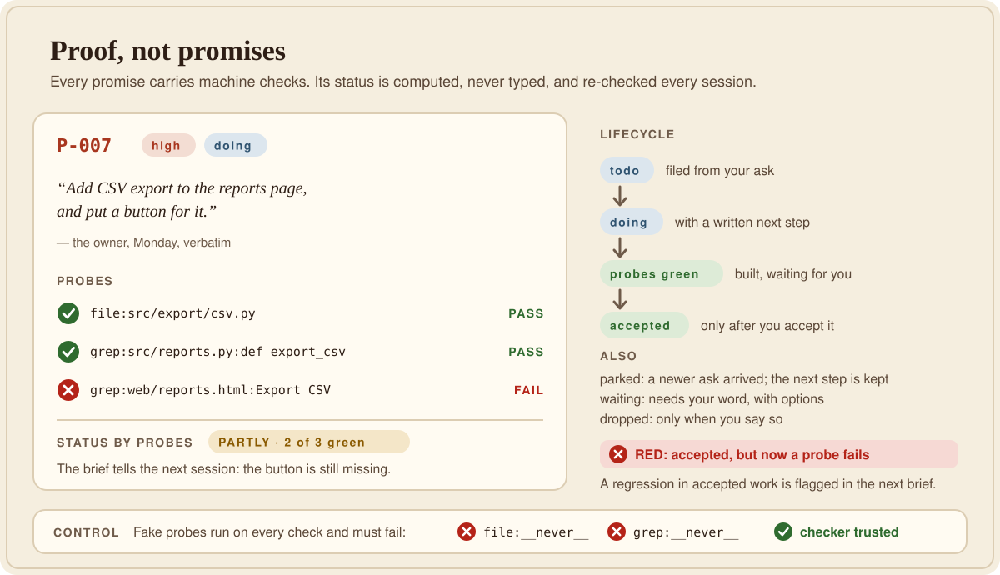

  

<h1 align="center">Прораб · Foreman</h1>

  <b>Обещания проекта не теряются.</b> 
  Прораб для Claude Code записывает каждую вашу просьбу дословно, прикрепляет к ней машинные проверки 
  и спрашивает «а правда построено?», пока ответ не станет «да».

  <a href="#установка-2-минуты"><b>Установка за 2 минуты</b></a> ·
  <a href="#как-это-работает">Как это работает</a> ·
  <a href="#консилиум-для-сложных-случаев">Консилиум</a> ·
  <a href="#уроки-прораб-учится-на-ваших-поправках-20">Уроки (2.0)</a> ·
  <a href="#чем-прораб-отличается-от-аналогов">Отличия от аналогов</a> ·
  <a href="README.md">English</a>

---

## Для кого и зачем

**Для кого.** Для всех, кто строит проект вместе с Claude Code долго: неделями, через много сессий.

**Проблема.** Claude забывает. В понедельник вы попросили сделать одно. В среду контекст сжался, Claude переключился на новую просьбу, и старая тихо выпала. Никто не виноват, она просто потерялась. Прораб родился после ревизии одного такого проекта: она нашла **7 потерянных обещаний одного рода**.

  

## Как Прораб это лечит

- **Один реестр ваших просьб**: `.foreman/promises.jsonl`. В каждом пункте ваши слова дословно и машинные **пробы**: «этот файл есть», «эта строка в коде появилась», «эта страница отвечает».
- **«Сделано» никто не пишет руками.** Его вычисляет проверка по пробам. Есть и **контроль**: заведомо ложные пробы обязаны проваливаться. Если вдруг прошла, проверке не верят.
- **Три автомата (хуки Claude Code):**
  1. ваша просьба сама попадает во «входящие»;
  2. в конце ответа Claude один раз напоминают её разобрать: завести пункт или отметить «не задача»;
  3. при старте сессии и **после сжатия контекста** Claude получает сводку из реестра, а не из пересказа.
- **«Парковка».** Новая просьба посреди работы: сначала текущему делу записывается «следующий шаг», потом новое.
- **Красная лампочка.** Если принятая работа сломалась и пробы перестали сходиться, пункт загорается КРАСНЫМ в следующей сводке.
- **Агент `foreman`** судит то, что пробы не могут: сделано ли по смыслу, что забыто, три следующих шага. Пишет вам один экран простыми словами.

  

## Как это работает

  

  

Виды проб:

| Проба | Зеленеет, когда | Пример |
|---|---|---|
| `file:путь` | файл есть (можно маску) | `file:src/export/*.py` |
| `grep:файл:регулярка` | в коде есть шаблон | `grep:src/app.py:def login` |
| `nogrep:файл:регулярка` | файл есть, а шаблона **больше нет** | `nogrep:README.md:TODO` |
| `doc:файл:слово` | слово есть в документации (регистр не важен) | `doc:docs/api.md:export` |
| `get:адрес` | HTTP-запрос отвечает кодом ниже 400. Если сервер лежит, это «не проверено», а не «не сделано» | `get:http://localhost:8000/health` |
| `cmd:команда` | команда завершается с кодом 0. **Выключено по умолчанию**, потому что запускает код (`allow_cmd`) | `cmd:pytest -q tests/test_login.py` |

## Консилиум для сложных случаев

Бывают трудные обещания: первая попытка дважды не прошла пробы, или ошибка стоит дорого (архитектура, модель данных, публичный API). Для них у Прораба есть **консилиум**: короткий ограниченный поиск, который хранит лучшее *проверенное* решение, а не бесконечно переписывает последнее.

Больше переписываний не значит лучше. Модель, которая шлифует свой ответ, часто его портит, а при слабом судье каждый лишний виток только добавляет уверенности в ошибке. Поэтому консилиум устроен так:

1. **Сначала критерии.** Пробы пункта и короткая рубрика мягких критериев задаются *до* поиска. После первого раунда они заморожены: `foreman.py` не даст их изменить без `--force`.
2. **Лидер сохраняется.** Текущая версия всегда участвует в сравнении, и её заменяют только тем, что доказуемо лучше.
3. **2–3 по-настоящему разных кандидата** за раунд, каждый в своём git worktree. Для необратимых действий (деплой, миграции, удаление) кандидатами бывают только *планы*, а не повторные исполнения.
4. **Объективная проверка:** `foreman.py compare` прогоняет одни и те же пробы по всем кандидатам рядом.
5. **Слепой судья:** агент `foreman-judge` ранжирует анонимных кандидатов X/Y/Z по замороженной рубрике, с доказательствами, не зная, кто из них лидер. Ответ «ничья» допустим.
6. **Журнал и правило остановки:** `foreman.py round` записывает каждый раунд и говорит СТОП после 2 раундов без улучшения или 3 раундов всего. Вы получаете **лучшую** найденную версию, а не последнюю, и короткий отчёт: что пробовали и что отвергли. Если выбор вкусовой, финалисты приходят к вам.

Запустить: скажите **«консилиум по P-007»** (или «подумай как следует»). Простым задачам он не нужен: консилиум стоит нескольких лишних проходов, и Прораб предлагает его только там, где это окупается.

## Уроки: Прораб учится на ваших поправках (2.0)

Обещания — это **что** вы просили. Уроки — **как** вы хотите, чтобы делалось. Когда вы поправляете Claude («опять прислал огромную
таблицу, ничего не видно»), поправка тоже не должна исчезать вместе с сессией.

- **Поправка становится правилом** в `.foreman/rules.jsonl`: *когда* (ситуация) → *что делать* + ваши слова **дословно** + несколько
  слов-ключей по-русски и по-английски. Правило, записанное Claude, рождается **«предложено»**; **«принято»** оно становится только вашим
  словом (`rule accept R-003`). Догадка агента — не закон.
- **Находится снова перед следующим действием.** Хук сообщения ищет по вашим правилам (основы слов, синонимы, BM25 с полем «когда») и
  показывает 1–3 подходящих. Обычное сообщение стоит **ноль** символов; жёсткий потолок — 1 200 символов на сообщение.
- **Поправка обязана оставить запись.** Если ваше последнее сообщение похоже на поправку («опять», «забыл», «я же просил»…), конец хода
  блокируется, пока правило действительно не записано (запись в правила или журнал после вашего сообщения) или Claude не объяснит
  «не поправка: …». Одного слова «записано» мало.
- **Лестница для повторов:** уровень 0 заметка → 1 правило (находится по словам) → 2 горячее (всегда в сводке сессии) → 3 **страж**: проба,
  которую проверяют в конце каждого хода (`nogrep:README.md:TODO`). Страж, ставший красным, блокирует один раз; красный с самого начала
  никогда не запирает работу.
- **Качество меряется.** У правила хранится сообщение, из которого оно родилось (и по желанию — на котором оно срабатывать НЕ должно);
  `recall --eval` считает recall@3 и ложные срабатывания на вашем же проекте.
- **Дружит со встроенной памятью Claude Code.** Прораб читает её (и `CLAUDE.md`, навыки) как источник и ничего туда не пишет: ваши
  решения — в `rules.jsonl`, рабочие заметки Claude — в его памяти.
- **Пустой старт.** В новом проекте правил нет, и он ничего не платит до первой поправки. Не нужны уроки — ставьте с `--modules promises`.

Откуда: система памяти проекта, в котором родился Прораб (она выросла из
[google-research/harness2](https://github.com/google-research/harness2)), урезанная до того, что пригодится любому проекту; устройство
выбрал консилиум трёх моделей (Claude Fable, Gemini, GPT) 4 ноября 2026.

## Чем Прораб отличается от аналогов

**Прораб не ещё один менеджер задач.** Менеджеры задач ведут работу, которую планирует агент. Прораб охраняет обещания, которые дали *вам*, вашими же словами, и сам проверяет, выполнены ли они.

| | **Прораб** | Встроенный список задач Claude Code | [Task Master](https://github.com/eyaltoledano/claude-task-master) | [Backlog.md](https://github.com/MrLesk/Backlog.md) |
|---|---|---|---|---|
| Ловит ваши просьбы автоматически | ✅ каждое сообщение, хуком | ➖ Claude сам составляет список из плана | ➖ задачи генерируются из PRD | ➖ задачи создаются через CLI или MCP |
| Хранит ваши слова дословно | ✅ цитата в каждом пункте | ❌ формулировки Claude | ❌ сгенерированные формулировки | ➖ что впишут |
| «Сделано» доказывается машинной проверкой | ✅ шесть видов проб | ❌ отмечает агент | ❌ отмечает агент или вы | ❌ отмечает агент или вы |
| Проверка проверяет сама себя | ✅ контрольные пробы | ❌ | ❌ | ❌ |
| Возвращает незаконченное после сжатия контекста | ✅ автоматически, хук `SessionStart` | ➖ в пределах своей сессии | ➖ если агент обратится | ➖ если агент прочитает |
| Ловит поломку уже принятой работы | ✅ КРАСНОЕ в сводке | ❌ | ❌ | ❌ |
| Сложные случаи: сравнивает кандидатов, оставляет лучший проверенный | ✅ консилиум со слепым судьёй | ❌ | ❌ | ❌ |
| Учится на ваших поправках: ваши слова становятся правилом, которое находится и соблюдается | ✅ уроки, стоп-ворота, стражи | ➖ свои заметки Claude (память), без принуждения | ❌ | ❌ |
| Планирование, разбивка, канбан | ❌ не его задача | ➖ простой чек-лист | ✅ PRD → задачи с зависимостями | ✅ канбан-доска и веб-интерфейс |
| Что нужно установить | один файл на Python, только стандартная библиотека | ничего, встроен | пакет Node.js + провайдер модели или Claude Code CLI | пакет npm/bun/Homebrew/Nix |

✅ да · ➖ частично или косвенно · ❌ нет. По публичной документации проектов на ноябрь 2026 года; если что-то устарело, <a href="https://github.com/BenderBlender/Claude-Code-Foreman/issues">напишите в Issues</a>.

**Преимущества:**

- **Ноль усилий.** Вы общаетесь с Claude как обычно, учёт ведут хуки.
- **Честность по устройству.** Никто не может отметить «сделано» для красоты: решают пробы, а контроль следит за самими пробами.
- **Для длинных проектов.** Недели сессий, десятки сжатий, просьбы мимоходом: именно там всё и теряется, и именно там Прораб полезнее всего.
- **Дружит с другими.** Планируйте в Task Master или Backlog.md, а Прораб следит, чтобы ни одна ваша просьба не выпала.
- **Безопасно попробовать.** Трогает только папку проекта, сначала сохраняет копию настроек, удаляется чисто и оставляет ваши данные.

## Установка (2 минуты)

Нужны **Claude Code** и **Python 3.8+**: [python.org](https://www.python.org/downloads/), на Windows отметьте «Add python.exe to PATH».

1. Скачайте Прораба: `git clone https://github.com/BenderBlender/Claude-Code-Foreman.git` или **Code → Download ZIP** на этой странице.
2. Установите в свой проект:
   - **Windows:** дважды щёлкните `install.bat`, перетащите в окно папку своего проекта и нажмите Enter. Можно и перетащить папку проекта прямо на `install.bat`.
   - **macOS / Linux:** `./install.sh /путь/к/проекту`
   
   Английские сообщения: добавьте `--lang en`.
3. Перезапустите Claude Code в этом проекте (или откройте `/hooks` и примите изменения).

**Что меняется в проекте** (только внутри его папки):

| Что | Где | Зачем |
|---|---|---|
| движок и ваши данные | `.foreman/` (`foreman.py`, `promises.jsonl`, `inbox.jsonl`, `config.json`) | реестр, входящие, настройки |
| три хука | `.claude/settings.local.json`: личный файл, обычно не уходит в git | старая версия сохраняется в `.foreman/backup/` |
| агент `foreman` | `.claude/agents/foreman.md` | отчёт одним экраном |
| слепой судья | `.claude/agents/foreman-judge.md` | для консилиума |
| процедура консилиума | `.claude/skills/foreman-council/SKILL.md` | загружается, только когда идёт консилиум |
| раздел правил | `CLAUDE.md`, между `<!-- foreman:start -->` и `<!-- foreman:end -->` | остальной текст файла не трогается |
| уроки (2.0) | `.foreman/` (`recall.py`, `lexicon.json`, `rules.jsonl`, `ledger.md`, `eval.jsonl`, `events.jsonl`, `RULES.md`) | `lexicon.json` — ваш, при обновлении не перезаписывается |

## Как пользоваться

- Просите как обычно. Claude сам заведёт пункт с вашей цитатой и пробами.
- **«Что у нас по проекту?»**: сводка и подробный отчёт агента `foreman` (сделано, в работе, ждёт вашего слова, забыто, три следующих шага).
- Вручную:
  - `python .foreman/foreman.py brief`: коротко;
  - `status`: отчёт в `.foreman/STATUS.md`;
  - `add` / `set` / `take` / `skip`: правка реестра (подробности в шапке `foreman.py`);
  - `check` / `compare` / `round`: консилиум (пробы на папке кандидата, сравнение кандидатов, журнал раундов);
  - `recall <слова>`: правила, которые подходят к тому, что собираетесь делать;
  - `rule add '{"when": …, "do": …, "quote": …, "keys": …}' --situation "сообщение владельца"` · `rule accept R-003` (ваше «да») ·
    `rule set R-003 hot=true` · `rule set R-003 guard=nogrep:README.md:TODO level=3` · `recall --eval`: уроки.
  В Windows PowerShell 5.1 кавычки внутри JSON-аргумента теряются — кладите JSON в файл и передавайте `@rule.json`.
- Принять правило: скажите Claude «R-003 принимаю» — статус станет «принято».
- Принять работу: скажите Claude «P-007 принимаю», и статус станет `accepted`.

## Настройки (`.foreman/config.json`)

- `"lang": "ru"|"en"`: язык сообщений;
- `"stale_days": 3`: через сколько дней пункт «в работе» считается застрявшим;
- `"allow_cmd": false`: разрешить пробы-команды `cmd:` (они запускают код, поэтому выключены);
- `"orphans": {"candidates": ["src/**/*.py"], "corpus": ["**/*.py", "**/*.md"]}`: искать брошенные файлы, на которые никто не ссылается;
- `"extra_ask_cues": ["регулярка"]`: свои слова-признаки просьбы;
- `"council": {"candidates": 2, "max_rounds": 3, "stop_after": 2}`: кандидатов за раунд, предел раундов и сколько раундов без улучшения останавливают консилиум;
- `"modules": {"promises": true, "lessons": true, "board": false}`: выключенный модуль ничего не добавляет ни в один хук (`install.py --modules promises`);
- `"budget": {"prompt_chars": 1200, "session_chars": 2000, …}`: жёсткие потолки того, что хуки добавляют в контекст;
- `"lessons": {"stop_gate": "correction", "rules_extra": [], "memory_dir": "auto", …}`: стоп-ворота (`off` / `correction` / `all`), свои
  признаки поправки, чужая книга правил для поиска (только чтение), папка памяти Claude Code (только чтение).

## Удаление

`install.bat "папка" --uninstall` (или `./install.sh папка --uninstall`). Убирает хуки, агента и раздел CLAUDE.md. Ваши данные в `.foreman/` остаются. С `--purge` папка откладывается в сторону как `.foreman_removed_<время>`, но не стирается.

## Откуда это

Сделано Claude вместе с кинопродюсером, строящим 3D-студию для превиза, в ноябре 2026 года. Прораб родился после ревизии, которая нашла 7 потерянных обещаний одного рода. Устройство выбрал консилиум из четырёх моделей (Fable, Claude-критик, ChatGPT, Gemini). Все четыре сказали одно: отдельный «начальник», который читает те же записи, терял бы так же. Нужен реестр, где готовность вычисляет проверка, а не память.

Другие инструменты ведут задачи. Прораб ведёт **обещания человека дословно** и сам проверяет, выполнены ли они.

## Лицензия

[MIT](LICENSE) © 2026 BenderBlender. Отзывы и ошибки: [Issues](https://github.com/BenderBlender/Claude-Code-Foreman/issues).
